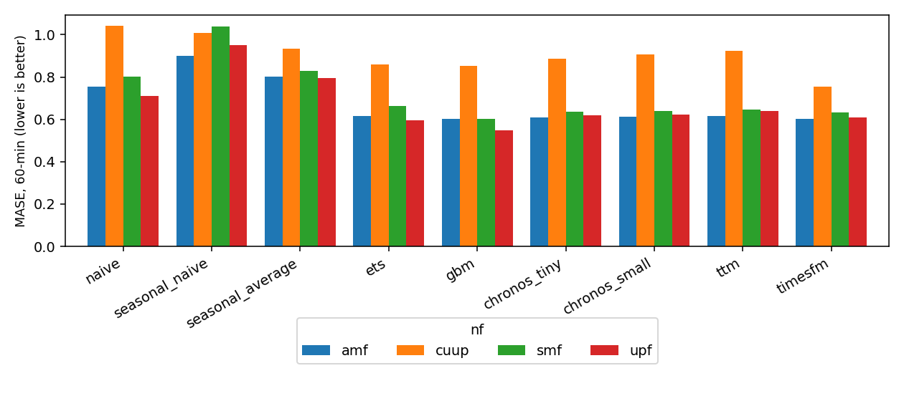

# nfcast

Comparing time-series foundation models with classical methods for forecasting telemetry from 5G network functions (UPF, AMF, SMF, CU-UP), and checking whether better forecasts save energy.

## What I did
- Wrote a simulator that produces one-minute telemetry (traffic, CPU, pod utilisation, memory, power) for the four network-function types under a reactive Kubernetes-style autoscaler. It has bursty traffic, daily and weekly cycles, surges, registration storms, memory-leak restarts and a periodic housekeeping task.
- Benchmarked naive, seasonal naive, seasonal average, Holt-Winters ETS and gradient boosting against the foundation models Chronos-Bolt (tiny, small), Tiny Time Mixer (TTM r2) and TimesFM 2.0 (500M).
- Added split-conformal prediction intervals for every model.
- Fine-tuned TTM fully and with LoRA on 1, 5, 20 and 100 percent of the training budget (3 seeds), and tested transfer to unseen network-function types, targets and instances.
- Ran a closed-loop autoscaling test: scale up and down using each forecast, and compare energy and SLA-violation minutes with a reactive autoscaler.

## Results
Test period, 80 series. MASE is lower-is-better.

| model | MASE 15 min | MASE 60 min | coverage 60 min |
|---|---|---|---|
| naive | 0.752 | 0.828 | 0.798 |
| seasonal naive | 0.982 | 0.974 | 0.803 |
| ETS | 0.640 | 0.683 | 0.806 |
| gradient boosting | 0.597 | 0.651 | 0.793 |
| Chronos-Bolt tiny | 0.599 | 0.688 | 0.801 |
| Chronos-Bolt small | 0.606 | 0.695 | 0.800 |
| TTM, zero-shot | 0.613 | 0.707 | 0.802 |
| **TimesFM 2.0, zero-shot** | **0.568** | **0.649** | 0.805 |

- Zero-shot TimesFM is best at 15 minutes and ties gradient boosting at 60 minutes.
- CU-UP is the hardest network function for every model. At 60 minutes TimesFM scores 0.753 on it, gradient boosting 0.851.
- Fine-tuning TTM at the full budget: zero-shot 0.707, full fine-tuning 0.673, LoRA 0.671 (LoRA trains 6% of the parameters).
- Forecast-based scaling used 5.5 to 6.1 percent less energy than the deployed autoscaler. A perfect forecast saves 6.0 percent with zero violations.




Full tables: [results/REPORT.md](results/REPORT.md).

## How it was built

```
simulator (sim.py) -> forecasters -> conformal intervals
                   -> TTM fine-tuning (full + LoRA) -> closed-loop autoscaling test
```

Config is in `configs/default.yaml` (seed 11, 21 days, 6 instances per network function). 28 tests.

## Tech stack
Python, PyTorch, Transformers, Chronos-Bolt, Tiny Time Mixer, TimesFM, LoRA (PEFT), statsmodels, scikit-learn, pandas, matplotlib, pytest.
