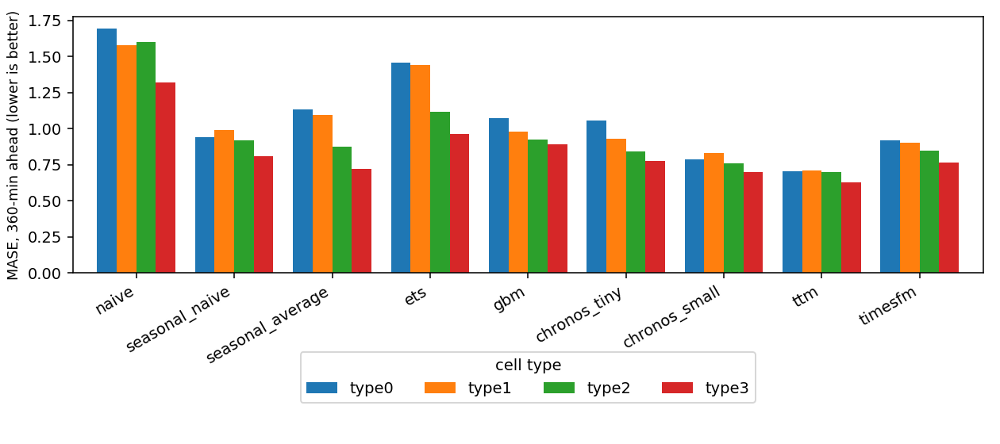
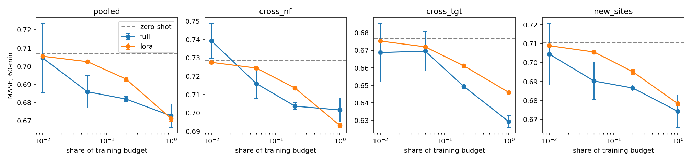
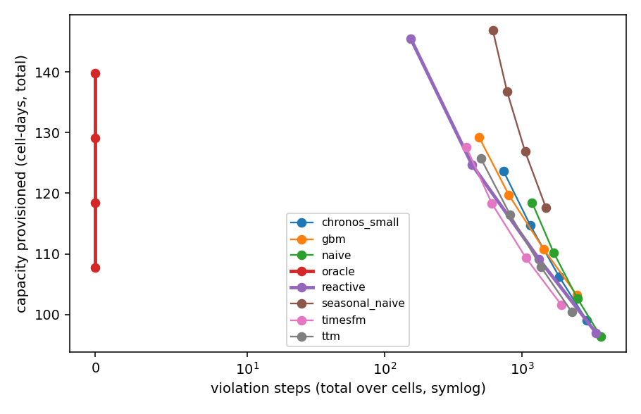

# nfcast

Comparing time-series foundation models with classical methods for forecasting real cellular traffic, and checking whether better forecasts let a cell run leaner.

## What I did
- Used the Telecom Italia Big Data Challenge data for Milan: every 10 minutes, internet, call and SMS activity for each 235 m grid square, 35 days. I clustered the weekly profile of the busiest 1,500 squares into four cell types and drew cells from each, giving 48 series for the benchmark (21 days to train, 5 to calibrate, 9 to test).
- Benchmarked naive, seasonal naive, seasonal average, Holt-Winters ETS and gradient boosting against the foundation models Chronos-Bolt (tiny, small), Tiny Time Mixer (TTM r2) and TimesFM 2.0 (500M), zero-shot.
- Added split-conformal prediction intervals for every model.
- Fine-tuned TTM fully and with LoRA on 1, 5, 20 and 100 percent of the training budget (3 seeds), and tested transfer to unseen cell types, targets and cells.
- Replayed capacity planning on the real traffic: set the capacity of a cell from each forecast and compare capacity used and overload steps with a reactive rule.
- **v2:** averaged and stacked the models, and planned capacity from a *calibrated peak forecast* (the forecast peak times a ratio learned on the calibration days) instead of a hand-picked headroom.

## Results
Test period, 48 series. MASE is lower-is-better; coverage is for 80% intervals.

| model | MASE 1 hour | MASE 6 hours | coverage 6 hours |
|---|---|---|---|
| naive | 0.650 | 1.547 | 0.784 |
| seasonal naive | 0.915 | 0.915 | 0.859 |
| ETS | 0.939 | 1.244 | 0.820 |
| gradient boosting | 0.581 | 0.965 | 0.809 |
| Chronos-Bolt tiny | 0.541 | 0.901 | 0.820 |
| Chronos-Bolt small | **0.518** | 0.769 | 0.837 |
| TimesFM 2.0 | 0.543 | 0.856 | 0.837 |
| TTM, zero-shot | 0.532 | **0.684** | 0.833 |

- Zero-shot foundation models beat the classical methods at both horizons; at 6 hours TTM is 29% better than gradient boosting.
- Fine-tuning TTM at the full budget: zero-shot 0.684, full fine-tuning 0.683, LoRA **0.667** (LoRA trains 6% of the parameters).
- A perfect forecast would let a cell use 25.9% less capacity than the reactive rule with no overloads.

**v2 ensembles.** Averaging TTM, both Chronos models and TimesFM gives **0.501** at 1 hour (best single model 0.518). At 6 hours TTM alone is best (0.684); stacking with weights learned on the calibration days gives 0.690.

**v2 capacity plans.** Compared with the best of ten tuned reactive rules, planning from a calibrated peak forecast used about **3 to 4% less capacity** at the same number of overload steps (for example 4.0% less for the mean of the three foundation models at 1000 overload steps, 95% interval 2.5 to 4.8).







Full tables: [results/REPORT.md](results/REPORT.md). The v2 comparison is in [docs/V2.md](docs/V2.md).

## How it was built

```
Milan data -> cell panel -> forecasters -> conformal intervals
           -> TTM fine-tuning (full + LoRA) -> capacity-planning replay
           -> v2: cached forecasts -> ensembles, calibrated-peak plans
```

Config is in `configs/default.yaml` (seed 11). 25 tests.

## Tech stack
Python, PyTorch, Transformers, Chronos-Bolt, Tiny Time Mixer, TimesFM, LoRA (PEFT), scikit-learn, Polars, pandas, matplotlib, pytest.

## Data
Barlacchi et al., *A multi-source dataset of urban life in the city of Milan and the Province of Trentino*, Scientific Data, 2015 (ODbL).
